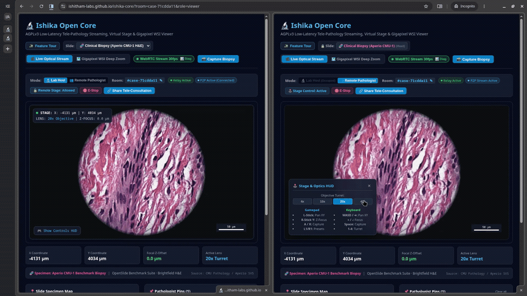
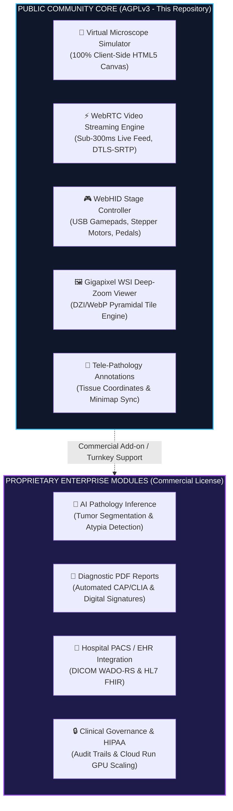

# 🔬 Ishika Open Core

[](LICENSE)
[](#-commercial-licensing--turnkey-deployments)
[](#-zero-cost--privacy-first-deployment-architecture)
[](#3-test-webrtc-streaming-locally)
[](#-system-architecture-open-core-model)

> **Browser-native, low-latency tele-pathology streaming, WebHID microscope stage controls, and gigapixel Whole Slide Image (WSI) deep-zoom viewer.**

Ishika connects optical laboratory microscopes directly to modern web browsers via **30 FPS peer-to-peer WebRTC video streaming** and **WebHID hardware stage control**, while rendering **gigapixel WSI biopsy slides locally at 60 FPS** via HTML5 Canvas (`requestAnimationFrame`) with zero desktop software installation.

---

<p align="center">
  <a href="https://ishitham-labs.github.io/ishika-core/">
    
  </a>
  <br />
  <em>⚡ Live Tele-Pathology: Sub-100ms P2P WebRTC Streaming & Motorized Stage Synchronization between Lab Host and Remote Pathologist.</em>
</p>

---

## 🚀 Live Interactive Demo (Zero Hardware Required)

👉 **[Launch Live Demo](https://ishitham-labs.github.io/ishika-core/)** *(Works in any modern desktop browser)*

* **Optical Simulation & Biopsy Modes:** Dual-mode viewing toggling between an authentic Aperio CMU-1 clinical whole-slide scan (Brightfield H&E) and procedural benchmark tissue with 4x–40x optical magnification and Z focal depth-of-field.
* **Stage Controls:** Use `WASD` or `Arrow Keys` to pan, `+/-` to adjust Z-focus, and `1-4` to switch objective lenses.
* **Gamepad / Pedal:** Plug in any standard USB controller or foot pedal to test instant WebHID actuation (Chrome/Edge/Chromium).
* **Gigapixel WSI Deep Zoom:** Toggle to the **WSI Deep Zoom** tab to pan and zoom across whole-slide biopsy specimens.
* **Slide Minimap:** Click anywhere on the glass slide minimap to immediately jump the motorized stage.

---

## 🏛️ System Architecture: Open Core Model

Ishika is partitioned into an open-source community foundation and a closed-source clinical enterprise package:



---

## ⚡ Quickstart (Local Development)

### Prerequisites
* Node.js v20+ 
* Modern desktop browser (Chrome, Edge, or Brave recommended for WebHID pedals; Safari and Firefox supported for WebRTC streaming & stage controls)

### 1. Clone & Install
```bash
git clone https://github.com/ishitham-labs/ishika-core.git
cd ishika-core
npm install
```

### 2. Run Tests & Typecheck
```bash
# Run unit tests (25 tests across optics, stage safety & coordinate projection, signaling schema validation, peer connection, and DZI pyramidal tile engine)
npm test

# Run automated WebRTC protocol and contract checks
npm run test:webrtc

# Run automated headless dual-browser WebRTC verification via Chrome CDP
npm run test:two-browser:headless

# Verify TypeScript compilation
npm run typecheck
```

### 3. Test WebRTC Streaming Locally
You can test the WebRTC streaming pipeline across two browsers or via the standalone loopback diagnostic harness:

* **Two-Browser Tele-Consultation Runner (Chrome Host ↔ Firefox/Chrome Viewer):**
  ```bash
  npm run test:two-browser
  # or against the live Cloudflare Worker relay:
  npm run test:two-browser:cloudflare
  ```
* **Interactive Loopback Diagnostic Server:**
  ```bash
  npm run test:webrtc:ui
  ```
  Opens [http://localhost:3030](http://localhost:3030) featuring a side-by-side loopback test harness with live 30 FPS canvas streaming (`canvas.captureStream(30)`), VP8/H.264 decoding, STUN traversal, real-time `getStats()` telemetry, and biopsy snapshot capture. (You can also double-click `scripts/webrtc_test.html` directly).

* **In-App Inspector:**
  Start the main app with `npm run dev` and click the **`WebRTC Stream 30fps 📊 Diag`** badge in the header to open the interactive in-browser diagnostic inspector.

### 4. Start Development Server & Deploy Signaling Worker
```bash
# (Optional) Start local WebSocket signaling server to test between different browsers on localhost
npm run signaling

# Start Vite development server
npm run dev

# (Optional) Deploy the Cloudflare Worker WebRTC signaling relay
npm run deploy:worker   # or: make deploy-worker
```
Open [http://localhost:3000](http://localhost:3000) in your browser.

---

## 📦 Monorepo Package Breakdown

| Package | Path | Description |
|---|---|---|
| `@ishika/controls` | `packages/controls` | Keyboard (`useKeyboardControls`), Gamepad (`useGamepad`), and WebHID (`useHidCaptureTrigger`) stage drivers. |
| `@ishika/simulator` | `packages/simulator` | Physical `StageController`, optical H&E histology canvas generator, and `canvas.captureStream()` pipeline. |
| `@ishika/streaming` | `packages/streaming` | `WebRtcPeerManager`, STUN/TURN traversal (`peer.ts`), `SignallingClient` (`signalling.ts`), and `useTeleconsultation`. |
| `@ishika/vision` | `packages/vision` | `ImagePyramid` multi-resolution patch manager and `optical-flow.ts` translation tracking. |
| `@ishika/signaling-worker` | `services/signaling-worker` | Cloudflare Worker WebRTC signaling room relay with Durable Objects ($0/mo). |
| `@ishika/viewer` | `apps/viewer` | React application featuring split-mode streaming, `TeleconsultationBar`, `ControllerOverlay`, `InteractiveOverlay`, and `Minimap`. |

---

## 🌐 Zero-Cost & Privacy-First Deployment Architecture

The public demo is architected to operate at **$0/month in cloud infrastructure costs** while enforcing a **zero-storage, peer-to-peer privacy boundary** for clinical microscopy media:

* **Zero Video Relaying & End-to-End Encryption (DTLS-SRTP):** Only transient ~1 KB SDP offers, answers, ICE candidates, and stage sync coordinates (`x, y, z, magnification`) pass through the signaling worker. Live microscope video streams **strictly peer-to-peer between browsers** via WebRTC (DTLS-SRTP encrypted in transit) and never touch or persist on any cloud server.
* **Ephemeral Signaling Relay ($0/mo):** Cloudflare Worker + Durable Objects (`services/signaling-worker`) routes handshake packets in memory only—with cryptographically isolated session room IDs, 16 KB frame caps, anti-spoofing sender verification, and zero database persistence of patient metadata.
* **Static Hosting ($0/mo):** GitHub Pages / Cloudflare Pages (unlimited static bandwidth with zero backend attack surface).
* **Client-Side Virtual Camera:** In-browser Canvas `captureStream(30)` eliminates server-side video ingestion compute.
* **NAT Traversal:** Google Public STUN (`stun:stun.l.google.com:19302`) for direct P2P hole-punching.
* **WSI Slide Tiles:** Pre-sliced WebP DZI tiles (`apps/viewer/public/specimens/clinical_tiles/`) are bundled directly for zero-latency static hosting; full multi-gigabyte SVS archives can be served from Cloudflare R2 (10 GB free with $0 egress) or an on-premise hospital LAN bucket.

---

## 💼 Commercial Licensing & Turnkey Deployments

### Dual-Licensing Terms
* **Open Source (AGPLv3):** Free for academic research, open-source projects, and individual hobbyists. If you provide a network service utilizing this code, you must release your complete modified source code under AGPLv3.
* **Commercial Enterprise License:** If you wish to embed Ishika into proprietary software, hospital systems, or closed-source commercial cloud offerings, you must obtain a commercial license.

### Turnkey Lab Deployment & Engineering Services
Ishitham provides specialized engineering and deployment services for diagnostic laboratories, CROs, and digital health platforms:
* **Hardware Integration:** Connecting existing optical microscopes (HDMI/USB C-mounts) to WebRTC streaming daemons with <300ms latency.
* **Private Cloud Deployments:** Private VPC sandbox environments (Google Cloud Run / AWS ECS) with role-based access and custom branding.
* **Clinical System Integrations:** Deep learning inference pipelines, hospital PACS (DICOM WADO-RS) connectors, and automated CAP/CLIA report generation.

**For enterprise licensing, pilot programs, or custom deployment quotes:**
* **Email:** `business@ishitham.com`
* **Website:** [https://ishitham.com](https://ishitham.com)
